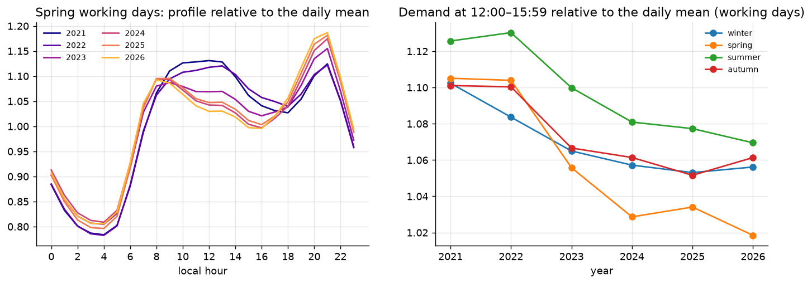

# How much electricity will Spain use tomorrow?

*Day-ahead forecasts of Spanish electricity demand from public data, with uncertainty ranges,
compared against the grid operator's own forecast.*

> **Draft, 13 November 2026.** All results are for the **validation year** (1 November 2024 to
> 31 October 2025), the year used to choose and tune the models. Scores on it are somewhat
> flattering. The final test year (November 2025 to October 2026) has not been scored yet, and the
> numbers in this report will be replaced by test-year numbers when it is.

## The short version

- Using only public data, a standard machine-learning model forecasts tomorrow's hourly demand
  with an average error of **2.0%** (538 MW on a demand of about 27,000 MW).
- Red Eléctrica (REE), the grid operator, does better: **1.7%** (455 MW). The gap is real, not
  noise, but it is small: 83 MW on average.
- Simple rules of thumb are far behind, at 4.5% or worse.
- The open model beats REE on 4 days out of 10, and clearly on unusually sunny days, where REE
  overestimates midday demand because rooftop solar panels cover more of it than expected.
- The uncertainty ranges are close to honest: the model's "90% range" contained the real value
  88% of the time.
- A second, statistical model is a little less accurate (2.2%) but can be read directly: heating
  starts below 16 °C, air conditioning above 20 °C, and each degree of heat costs almost twice
  as much electricity as each degree of cold.

## The question

Electricity cannot be stored cheaply at the scale of a country, so power plants must produce
almost exactly what is being consumed at every moment. To decide today which plants will run
tomorrow, the operator needs a forecast of tomorrow's demand, hour by hour.

This project asks how well that forecast can be made with public data and standard methods, and
whether the forecast can also say honestly how uncertain it is. A forecast of "31,000 MW at 8 pm"
is useful. A forecast of "31,000 MW, and between 29,800 and 32,100 with 90% probability" is more
useful, because it says how much backup to keep ready. It is only worth something if the 90% is
true.

Every forecast here is made as it would be in practice: at 10:00 in the morning, for the 24 hours
of the next day, using only information that existed at that moment. REE publishes its own
forecast at about 10:50, so the comparison slightly favours REE.

## The data

Three public sources, from January 2021 to October 2026:

- **Demand** for mainland Spain, and REE's day-ahead forecast, from REE's ESIOS service.
- **Weather** for ten large cities, combined into one national figure weighted by population,
  from Open-Meteo. For the forecasts, the models are given the weather *forecast* that existed
  at the time, not the weather that was later observed.
- **Public holidays**, national and regional, weighted by the population they affect.

Two things in the data needed care. The Iberian blackout of 28 April 2025 is left out (two days).
And in December 2025 REE changed what it publishes as "demand" to include an estimate of what
homes and businesses produce and consume themselves; the project removes that estimate so that the
whole period uses one definition.

## What drives demand

**The clock and the calendar.** Demand follows a daily and a weekly rhythm. Saturdays are 11% and
Sundays 16% below working days. A national holiday on a working day lowers demand by about 18%.

**Temperature.** Demand is lowest when the national mean temperature is between about 16 and
20 °C, and rises on both sides: heating when it is colder, air conditioning when it is hotter.

**Rooftop solar.** Panels on roofs do not appear as generation; they appear as demand that is
missing in the middle of the day. Between 2021 and 2025, midday demand fell by 2.7 GW while
evening demand rose by 0.8 GW. The shape of the day is changing year by year.

## The models

| Model | What it is |
|---|---|
| Rules of thumb | "Same hour last week", and the typical profile for that hour, weekday and time of year. They set the bar. |
| LightGBM | Gradient-boosted decision trees, the standard tool in industry. Fed recent demand, the calendar and weather forecasts. |
| Bayesian model | A statistical model built from parts with a meaning: daily and weekly rhythm, holidays, heating, cooling, solar. Less flexible, but its parameters can be read. |
| REE | The operator's published forecast. The benchmark, not a model of this project. |

## Results

Validation year, 363 days (lower is better, except coverage, which should be 90%):

| Forecast | Mean error (MW) | Mean error (%) | Probabilistic score, CRPS (MW) | Coverage of the 90% range (%) |
|---|---:|---:|---:|---:|
| Same hour last week | 1,438 | 5.30 | 903 | 85.1 |
| Typical profile | 1,221 | 4.47 | 696 | 85.0 |
| Bayesian model | 586 | 2.15 | 359 | 84.7 |
| LightGBM | 538 | 1.99 | 315 | 88.4 |
| **REE** | **455** | **1.67** | **271** | 88.0 |

REE publishes no uncertainty range; the one scored here is built from its own past errors.

- **Both models cut the error of the best rule of thumb by more than half.**
- **REE stays ahead.** LightGBM is 83 MW behind in daily mean error (between 38 and 130 MW with
  95% confidence), the Bayesian model 131 MW (76 to 184).
- **The weather forecast is not the problem.** Giving LightGBM the weather that was actually
  observed improves it by only 15 MW. Day-ahead weather forecasts are good enough; the gap to
  REE comes from somewhere else.

## Where the forecasts fail, and where they win

**They lose most on special days.** Over Christmas, LightGBM's error is 3.4% and the Bayesian
model's 4.9%, against REE's 1.9%. In Holy Week it is 2.2% and 3.0% against 1.1%. There are only
four Christmases in the training data, and REE has decades of them. This is mostly a *data*
limit, not a modelling one.

**They lose at night and in the early morning.** Between midnight and 6:00 REE's error is 1.1%,
LightGBM's 1.4% and the Bayesian model's 1.6%. Night demand is dominated by industry and by the
overall level, which REE probably tracks with information that is not public.

**They win on sunny days.** REE's midday error grows with how sunny the day is for the season.
In the sunny week of 25 March to 1 April 2025, REE's error was 4.6%, LightGBM's 2.8% and the
Bayesian model's 3.7%. The open models are given solar radiation and learn that sunny middays
mean lower demand.

**A few bad days carry much of the error.** For REE, the worst tenth of days accounts for 23% of
its total error.

## Are the uncertainty ranges honest?

Mostly. LightGBM's 50, 80 and 90% ranges contained the outcome 48, 79 and 88% of the time. By
quarter, the 90% range covered between 85% and 98%.

The Bayesian model's ranges are too narrow: its 90% range covered 85%. Its uncertainty comes
straight from the model with no correction afterwards, and the model is more sure of itself than
it should be.

One approach failed outright and was dropped: training a separate LightGBM for each edge of the
range gave a "90% range" that held only 68% of the time. Ranges built from the model's own past
errors are simpler and honest.

## What the Bayesian model says about Spain

Its accuracy does not justify it; what it explains does.

- **Heating starts below 16.1 °C and cooling above 20.3 °C** (national mean temperature).
- **Heat costs more than cold.** One degree more above the cooling threshold adds 850 MW on
  average over the day, and 1,230 MW at 16:00. One degree less below the heating threshold adds
  450 MW on average, and 640 MW at 20:00.
- **Buildings remember.** Demand responds to the temperature of the past day or two, with half of
  the weight on the last 19 hours.
- **A national holiday on a Wednesday removes 4.6 GW** on average, and 7.9 GW at 8:00.
- **Solar grows every year.** On a clear midday the sun now lowers demand by about 2.9 GW; in
  2021 it made almost no difference.

## What I would do next

1. **Score the test year**, once, with everything fixed, and replace the numbers in this report.
2. **Special days.** Treat Christmas and Holy Week as their own problem: more years of history,
   or a model of those weeks alone.
3. **Combine the models.** LightGBM and REE fail on different days, so a combination should beat
   both. Using REE's forecast as an input is realistic in industry and has not been tried here.
4. **Fix the Bayesian ranges** with the same correction used for LightGBM.
5. **Whole-day scenarios.** Errors within a day move together. Models that describe the 24 hours
   jointly (a recurrent network and a normalizing flow are planned) matter for anyone who has to
   plan a full day.

---

## Technical appendix

**Target and horizon.** Hourly mean peninsular demand (ESIOS indicator 1293, MW), for the 24
local hours of day *d*+1, issued at 10:00 Europe/Madrid on day *d*. Benchmark: ESIOS indicator
1775, published at about 10:50 on day *d*.

**Splits by target day.** Train 2021-01-01 to 2024-10-31; validation 2024-11-01 to 2025-10-31;
test 2025-11-01 to 2026-10-31 (not scored). 28–29 April 2025 are masked from training and scoring.

**Backtest.** Rolling origin: for each target day a model receives only the rows before the issue
time, plus calendar and weather-forecast columns for the target day. A unit test corrupts
everything after the issue time and checks that forecasts do not change.

**Weather.** Open-Meteo reanalysis for training. At prediction time the "forecast" variants use
the forecast archived two days before each target hour, which was always issued before 10:00 on
day *d*. "Oracle" variants use reanalysis for the target day.

**LightGBM.** One model for all hours, 55 features, squared error, 15 leaves, 2,000 rounds at
rate 0.03, recency weights with a 2-year half-life, refitted every 28 days. Quantiles are the
point forecast plus empirical quantiles by hour of its own out-of-sample errors over the previous
365 days.

**Bayesian model (NumPyro).** Two stages. Stage 1 is the structural mean: hierarchical weekday
profiles (Fourier, 5 harmonics), special-day profiles, a yearly cycle and its interaction with
the daily shape, a piecewise-linear level, a linear drift of the daily shape, a radiation effect
that drifts in time, and smooth-hinge heating and cooling on exponentially smoothed temperature.
Stage 2 models the 24-hour residual vector of the target day as multivariate Student-t, given the
residuals known at issue time. The scored variant uses one NUTS fit (4 chains, 500 warm-up and 500
draws each) on the training period, fixed through the validation year. A variational
approximation refitted every 28 days scores the same (difference in daily MAE 1 MW) but
understates parameter uncertainty by a factor of about 3.

**Metrics.** MAE and MAPE on the point forecast. CRPS approximated from seven quantiles (5, 10,
25, 50, 75, 90, 95%) as twice the mean pinball loss, identical for all models. Coverage is the
share of hours inside the central interval. Model differences are tested on daily mean absolute
error with the Diebold–Mariano test (Newey–West variance) and a block-bootstrap 95% interval.

| Comparison (daily MAE) | Difference (MW) | 95% interval | p |
|---|---:|---:|---:|
| LightGBM − REE | +83 | 38 to 130 | 0.0003 |
| Bayesian − REE | +131 | 76 to 184 | 1e-6 |
| Bayesian − LightGBM | +48 | 4 to 92 | 0.03 |
| LightGBM, forecast − observed weather | +15 | 2 to 30 | |
| Bayesian, forecast − observed weather | +6 | −11 to 26 | 0.53 |

**Known limitations.**

- Features, settings and model structure were chosen on the validation year.
- The Bayesian model's first stage treats days as independent, so its credible intervals are too
  narrow.
- With forecast weather the Bayesian model has a bias of −118 MW (−16 MW with observed weather)
  that is not explained.
- The target definition after December 2025 relies on REE's own estimate of self-consumption.

**Reproduce.** `make setup`, `make data` (needs a free ESIOS token), `make train`,
`make evaluate`, `make app-data`, `make app`. Full detail: [`docs/DESIGN.md`](../docs/DESIGN.md)
and the notebooks in `notebooks/`.
