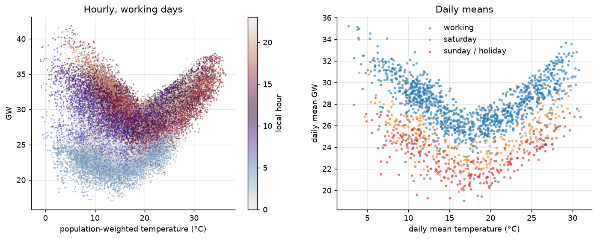
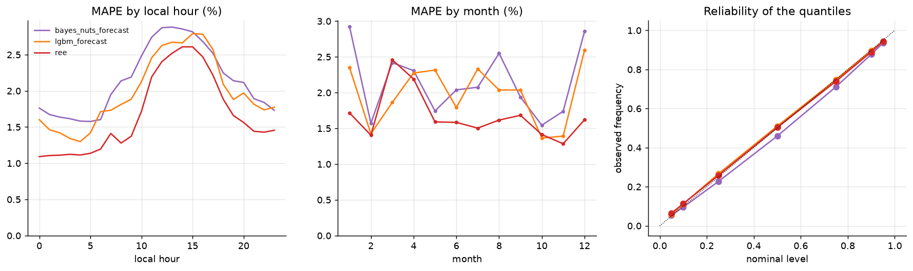
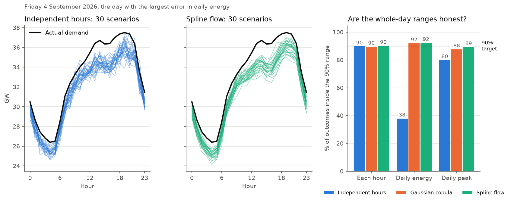
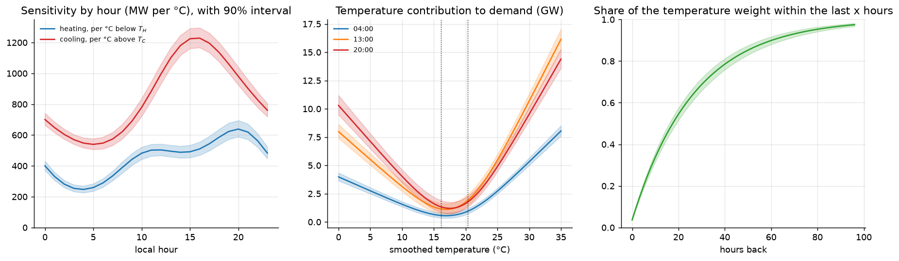

# How much electricity will Spain use tomorrow?

*Day-ahead forecasts of Spanish electricity demand from public data, with uncertainty ranges,
compared against the grid operator's own forecast.*

> **17 November 2026.** Headline results are for the **test year** (1 November 2025 to
> 31 October 2026), scored once after every choice had been fixed (16 November; the RNN on
> 17 November, with its configuration fixed on the validation year beforehand). The year before it (the
> validation year) was used to choose and tune the models; where a number or a figure comes from
> that year, the text says so.

## The short version

- Using only public data, a small recurrent neural network (RNN) forecasts tomorrow's hourly demand
  with an average error of **1.6%** (457 MW on a demand of about 28,000 MW).
- Red Eléctrica (REE), the grid operator, is still a little better: **1.5%** (426 MW). The gap is
  31 MW on average, at the edge of what can be told apart from noise. The RNN beats REE on
  43% of days.
- The standard machine-learning model, LightGBM, scores **2.0%** (553 MW), 127 MW behind REE.
  Simple rules of thumb are far behind, at 5%.
- LightGBM beats REE on 3 days out of 10. REE is weakest on unusually sunny days, where
  rooftop solar panels cover more of the midday demand than it expects; there the open model
  matches it.
- The uncertainty ranges are honest: the RNN's "90% range" contained the real value 91% of
  the time, LightGBM's 89%.
- A second, statistical model is a little less accurate (2.2%) but can be read directly: heating
  starts below 16 °C, air conditioning above 20 °C, and each degree of heat costs almost twice
  as much electricity as each degree of cold.
- The results held up out of sample. On the year used for tuning, the RNN scored 1.75%, LightGBM
  1.99% and REE 1.67%; REE and the RNN both did better in the test year, LightGBM about the same.
- For whole-day scenarios the hours must be tied together. Drawn independently, the "90% range"
  for a day's total energy held only 38% of the time; tied together by a Gaussian copula or a
  neural spline flow, 92%.

## The question

Electricity cannot be stored cheaply at the scale of a country, so power plants must produce
almost exactly what is being consumed at every moment. To decide today which plants will run
tomorrow, the operator needs a forecast of tomorrow's demand, hour by hour.

This project asks how well that forecast can be made with public data and standard methods, and
whether the forecast can also say honestly how uncertain it is. A forecast of "31,000 MW at 8 pm"
is useful. A forecast of "31,000 MW, and between 29,800 and 32,100 with 90% probability" is more
useful, because it says how much backup to keep ready. It is only worth something if the 90% is
true.

Every forecast here is made as it would be in practice: at 10:00 in the morning, for the 24 hours
of the next day, using only information that existed at that moment. REE publishes its own
forecast at about 10:50, so the comparison slightly favours REE.

## The data

Three public sources, from January 2021 to October 2026:

- **Demand** for mainland Spain, and REE's day-ahead forecast, from REE's ESIOS service.
- **Weather** for ten large cities, combined into one national figure weighted by population,
  from Open-Meteo. For the forecasts, the models are given the weather *forecast* that existed
  at the time, not the weather that was later observed.
- **Public holidays**, national and regional, weighted by the population they affect.

Two things in the data needed care. The Iberian blackout of 28 April 2025 is left out (two days).
And in December 2025 REE changed what it publishes as "demand" to include an estimate of what
homes and businesses produce and consume themselves; the project removes that estimate so that the
whole period uses one definition.

## What drives demand

**The clock and the calendar.** Demand follows a daily and a weekly rhythm. Saturdays are 11% and
Sundays 16% below working days. A national holiday on a working day lowers demand by about 18%.

**Temperature.** Demand is lowest when the national mean temperature is between about 16 and
20 °C, and rises on both sides: heating when it is colder, air conditioning when it is hotter.

**Rooftop solar.** Panels on roofs do not appear as generation; they appear as demand that is
missing in the middle of the day. Between 2021 and 2025, midday demand fell by 2.7 GW while
evening demand rose by 0.8 GW. The shape of the day is changing year by year.

## The models

| Model | What it is |
|---|---|
| Rules of thumb | "Same hour last week", and the typical profile for that hour, weekday and time of year. They set the bar. |
| LightGBM | Gradient-boosted decision trees, the standard tool in industry. Fed recent demand, the calendar and weather forecasts. |
| Bayesian model | A statistical model built from parts with a meaning: daily and weekly rhythm, holidays, heating, cooling, solar. Less flexible, but its parameters can be read. |
| Recurrent neural network (RNN) | A small network (a GRU) that reads the last week of demand and weather hour by hour and gives the forecast and its range for each hour of the next day. |
| REE | The operator's published forecast. The benchmark, not a model of this project. |

## Results

Test year, 364 days (lower is better, except coverage, which should be 90%):

| Forecast | Mean error (MW) | Mean error (%) | Probabilistic score, CRPS (MW) | Coverage of the 90% range (%) |
|---|---:|---:|---:|---:|
| Same hour last week | 1,393 | 4.99 | 878 | 89.3 |
| Typical profile | 1,462 | 5.07 | 695 | 88.4 |
| Bayesian model | 623 | 2.21 | 367 | 89.7 |
| LightGBM | 553 | 1.96 | 328 | 88.6 |
| Recurrent neural network (RNN) | 457 | 1.63 | 267 | 90.8 |
| **REE** | **426** | **1.53** | **250** | 90.3 |

REE publishes no uncertainty range; the one scored here is built from its own past errors.
11 June 2026, when demand fell about 7 GW below REE's forecast for a reason not investigated, is
left out for every forecast.

- **Every model cuts the error of the rules of thumb by more than half.**
- **REE stays ahead, but the RNN comes close.** In daily mean error the RNN is
  31 MW behind (between −1 and 61 MW with 95% confidence), LightGBM 127 MW (85 to 174) and the
  Bayesian model 197 MW (153 to 244). The RNN beats LightGBM by 96 MW and on 64% of days.
- **The weather forecast is not the problem.** Giving LightGBM the weather that was actually
  observed improves it by only 18 MW, the RNN by 10 MW. Day-ahead weather forecasts are good enough; the gap to
  REE comes from somewhere else.
- **The tuning year was not flattering for the open models, but the gap to REE grew.** On the
  validation year LightGBM scored 538 MW and the Bayesian model 586 MW, against 553 and 623 MW
  here. REE went from 455 to 426 MW, so the gap went from 83 to 127 MW. The RNN went the
  other way, from 475 to 457 MW.

## Where the forecasts fail, and where they win

**They lose most at Christmas.** Over Christmas, LightGBM's error is 3.3%, the Bayesian
model's 4.5% and the RNN's 2.7%, against REE's 2.3%. There are only a handful of Christmases in the training data,
and REE has decades of them. This is mostly a *data* limit, not a modelling one. Holy Week is
less clear: REE was far ahead in 2025 (1.1% against 2.2% and 3.0%) but not in 2026 (2.4% against
1.9% and 2.8%; the RNN 2.0%).

**They lose at night and in the early morning.** Between midnight and 6:00 REE's error is 1.2%,
LightGBM's 1.6%, the Bayesian model's 1.7% and the RNN's 1.3%. Night demand is dominated by industry and by the
overall level, which REE probably tracks with information that is not public.

**They come closest on sunny days.** REE's midday error grows with how sunny the day is for the
season: 2.5% on the sunniest tenth of days against 1.9% on the others. LightGBM's does not (2.5%
and 2.4%), so on those days the two are level. In the validation year the effect was stronger: in
the sunny week of 25 March to 1 April 2025, REE's error was 4.6%, LightGBM's 2.8% and the
Bayesian model's 3.7%. The Bayesian model does not share the advantage in the test year (3.5% at
midday on the sunniest days).

**A few bad days carry much of the error.** For REE, the worst tenth of days accounts for 21% of
its total error; for LightGBM, 23%; for the RNN, 20%.

## Are the uncertainty ranges honest?

Yes. LightGBM's 50, 80 and 90% ranges contained the outcome 50, 79 and 89% of the time. By
quarter, the 90% range covered between 87% and 93%. The RNN's covered 51, 81 and 91%.

The Bayesian model, taken as it comes, is more sure of itself than it should be: its own 90%
range covered 84%. Its ranges are therefore widened by a factor learned from its past errors
(about 15% for the 90% range), keeping the model's view of which hours and days are more
uncertain. After that correction its 50, 80 and 90% ranges covered 48, 78 and 90%.

The RNN has the same problem, worse: trained to give the ranges directly, its "90% range"
held only 74% of the time. It gets the same correction, which also removes a tendency to forecast
too low in the evening (the median of its past errors is used as its forecast).

One approach failed outright and was dropped: training a separate LightGBM for each edge of the
range gave a "90% range" that held only 68% of the time. Ranges built from the model's own past
errors are simpler and honest.

## Whole-day scenarios

A range for each hour is not enough for someone who plans a whole day: to size reserves or
schedule storage they need *scenarios*, possible shapes of the whole 24 hours. Errors at
neighbouring hours move together. If demand comes in high at 18:00, it will almost certainly be
high at 19:00 too, and forecasts of each hour on its own do not know that.

Three ways of turning the RNN's hourly ranges into whole-day scenarios were compared, all
learning only from the RNN's own past errors:

- **Independent hours:** each hour drawn from its own range. This is what a forecast of each
  hour on its own amounts to.
- **Gaussian copula:** the same hourly ranges, tied together by how the errors of each pair of
  hours moved together over the past year.
- **Neural spline flow:** a neural network that learns the shape of the whole day's error at
  once, adjusted to the day of the week, holidays, the season and the temperature.

*Left and centre: the day with the largest error in daily energy of the test year (4 September
2026). Neither model saw it coming; the difference is that independent scenarios zigzag hour to
hour, while the flow's move together as real days do. Right: how often the 90% ranges held
the outcome, test year.*

- **Tying the hours together is what matters.** With independent hours the hourly ranges are
  fine, but the 90% range for the day's total energy held only 38% of the time, and for the
  daily peak 80%. With the copula or the flow, 92% and 88 to 89%.
- **The flow is slightly better than the copula, but not clearly.** It scores better on every
  joint score but one, by about 1% on the energy score (the whole-day equivalent of the CRPS),
  and the difference is within noise on both the tuning year and the test year. With about a
  thousand days of past errors to learn from, a flexible model has little room to beat a simple
  one.
- **The flow needed one correction.** As trained it was too sure of itself (its 90% ranges held
  86% of the time). Widening its scenarios by a factor learned from recent days it had not
  trained on fixed that at a small cost.

## What the Bayesian model says about Spain

Its accuracy does not justify it; what it explains does. The numbers below come from the model
fitted on 2021 to October 2024.

- **Heating starts below 16.1 °C and cooling above 20.3 °C** (national mean temperature).
- **Heat costs more than cold.** One degree more above the cooling threshold adds 850 MW on
  average over the day, and 1,230 MW at 16:00. One degree less below the heating threshold adds
  450 MW on average, and 640 MW at 20:00.
- **Buildings remember.** Demand responds to the temperature of the past day or two, with half of
  the weight on the last 19 hours.
- **A national holiday on a Wednesday removes 4.6 GW** on average, and 7.9 GW at 8:00.
- **Solar grows every year.** On a clear midday the sun now lowers demand by about 2.9 GW; in
  2021 it made almost no difference.

## What I would do next

1. **Special days.** Treat Christmas and Holy Week as their own problem: more years of history,
   or a model of those weeks alone.
2. **Combine the models.** LightGBM and REE fail on different days, so a combination should beat
   both. Using REE's forecast as an input is realistic in industry and has not been tried here.
3. **Train the flow with the RNN.** The flow here only sees the RNN's output. Trained together
   with the network, it could learn which situations make whole-day errors likely.
4. **Train the RNN on forecast weather.** It is trained on observed weather only, and with
   weather forecasts it loses 10 MW; on the validation year it lost 39 MW.

---

## Technical appendix

**Target and horizon.** Hourly mean peninsular demand (ESIOS indicator 1293, MW), for the 24
local hours of day *d*+1, issued at 10:00 Europe/Madrid on day *d*. Benchmark: ESIOS indicator
1775, published at about 10:50 on day *d*.

**Splits by target day.** Train 2021-01-01 to 2024-10-31; validation 2024-11-01 to 2025-10-31;
test 2025-11-01 to 2026-10-31, scored once on 16 November 2026. 28–29 April 2025 and 11 June 2026
are masked from training and scoring.

**Backtest.** Rolling origin: for each target day a model receives only the rows before the issue
time, plus calendar and weather-forecast columns for the target day. A unit test corrupts
everything after the issue time and checks that forecasts do not change.

**Weather.** Open-Meteo reanalysis for training. At prediction time the "forecast" variants use
the forecast archived two days before each target hour, which was always issued before 10:00 on
day *d*. "Oracle" variants use reanalysis for the target day.

**LightGBM.** One model for all hours, 55 features, squared error, 15 leaves, 2,000 rounds at
rate 0.03, recency weights with a 2-year half-life, refitted every 28 days. Quantiles are the
point forecast plus empirical quantiles by hour of its own out-of-sample errors over the previous
365 days.

**Bayesian model (NumPyro).** Two stages. Stage 1 is the structural mean: hierarchical weekday
profiles (Fourier, 5 harmonics), special-day profiles, a yearly cycle and its interaction with
the daily shape, a piecewise-linear level, a linear drift of the daily shape, a radiation effect
that drifts in time, and smooth-hinge heating and cooling on exponentially smoothed temperature.
Stage 2 models the 24-hour residual vector of the target day as multivariate Student-t, given the
residuals known at issue time. The scored variant uses one NUTS fit (4 chains, 500 warm-up and 500
draws each) per scored year, on the data up to two days before that year starts and fixed
through it. The fit for the test year has 22 divergent draws in 2,000 and is used for forecasts
only. A variational
approximation refitted every 28 days scores the same or slightly better (daily MAE 11 MW lower on the test year, under 1 MW on the
validation year) but
understates parameter uncertainty by a factor of about 3. The predictive quantiles are
recalibrated: errors over the previous 365 days are divided by the width of the model's 5–95%
range, and each quantile becomes the median plus that width times the empirical quantile of those
standardised errors, pooled over hours. Without this step the test-year coverage is 44.9 / 73.3 / 84.4%;
with it 48.1 / 78.2 / 89.7% (validation year: 47.9 / 75.4 / 84.7% and 48.4 / 78.2 / 88.0%).

**Recurrent neural network (PyTorch).** A one-layer GRU encoder (64 units) over the last 168 hours of
demand, observed weather and calendar; a GRU decoder over the rest of the issue day and the target
day, fed with calendar, weather and the demand one week earlier; a head giving the seven
quantiles per hour, built so they cannot cross. About 30,000 parameters. Trained with the pinball
loss from a forecast origin at every hour of the history, AdamW, 40 epochs; refitted every 28 days
on data since 2021; the forecast is the mean of 3 seeds. Its ranges are recalibrated like the
Bayesian model's (as trained: 34.5 / 73.8% for the 50 / 90% ranges on the test year), and the
point forecast is the recalibrated median, a choice made on the validation year (MAE 498 to 475 MW
there; on the test year 494 to 457 MW). Each network trains in about 50 seconds on a GTX 1660
SUPER; a year's backtest takes about an hour.

**Whole-day scenarios.** Built on the RNN's forecasts with forecast weather. Marginals: the
seven recalibrated quantiles, interpolated linearly in normal-score space and extended linearly
beyond 5% and 95%. Copula: Gaussian, with the correlation of the 24 hourly normal scores over
the previous 365 days. Flow: a conditional neural spline flow (zuko; 5 transforms, 2 × 128
hidden units, 8 bins, mean of 3 seeds) over $3.29\,(y-\hat y)/w$, $w$ the RNN's raw 5–95%
width; context: weekday, holiday and season flags, day of year, mean temperature, mean log
width and the weather source. It learns from the RNN's out-of-sample errors on all days up to
two days before the target (a backtest over 2022 to October 2024 adds about 1,000 days),
refitted every 28 days, with early stopping on the latest 15% of days; after training its
scenarios are widened around each hour's median so that its 90% ranges cover 90% of those
held-out hours. 1,000 scenarios per day; clock-change days left out. The configuration was
fixed on the validation year before the test run.

| Test year, 362 days | Energy score | Variogram score | CRPS of the peak (MW) | CRPS of daily energy (GWh) |
|---|---:|---:|---:|---:|
| Independent hours | 1,998 | 26,852 | 359 | 6.49 |
| Gaussian copula | 1,949 | 23,823 | 370 | 5.54 |
| Spline flow | 1,931 | 23,245 | 355 | 5.56 |

Copula − independent, energy score: −49 (−56 to −44). Flow − copula: −18 (−65 to +28,
p = 0.44); variogram score −577 (−1,974 to +750, p = 0.40). Validation year: −66 (−76 to −59)
and −23 (−81 to +39).

**Metrics.** MAE and MAPE on the point forecast. CRPS approximated from seven quantiles (5, 10,
25, 50, 75, 90, 95%) as twice the mean pinball loss, identical for all models. Coverage is the
share of hours inside the central interval. Model differences are tested on daily mean absolute
error with the Diebold–Mariano test (Newey–West variance) and a block-bootstrap 95% interval.
Whole-day scenarios are scored with the energy score (the multivariate CRPS, in MW), the
variogram score of order 0.5, and the sample CRPS of the daily peak and of the daily energy,
all from 1,000 scenarios per day; differences are tested on the daily scores in the same way.
A sample CRPS per hour is not comparable to the seven-quantile CRPS of the other tables.

| Comparison (daily MAE, test year) | Difference (MW) | 95% interval | p |
|---|---:|---:|---:|
| LightGBM − REE | +127 | 85 to 174 | 2e-8 |
| Bayesian − REE | +197 | 153 to 244 | 3e-18 |
| Bayesian − LightGBM | +70 | 36 to 105 | 0.0001 |
| RNN − REE | +31 | −1 to 61 | 0.05 |
| RNN − LightGBM | −96 | −129 to −68 | 2e-9 |
| LightGBM, forecast − observed weather | +18 | 4 to 32 | 0.009 |
| Bayesian, forecast − observed weather | +9 | −5 to 24 | 0.18 |

On the validation year the first three were +83 (38 to 130), +131 (76 to 184) and +48 (4 to 92),
and RNN − REE +20 (−31 to 71).

**Known limitations.**

- Features, settings and model structure were chosen on the validation year. The figures and the
  parameter values in this report are from that year and its fit; only the scores were redone on
  the test year.
- The Bayesian model's first stage treats days as independent, so its credible intervals are too
  narrow.
- With forecast weather the Bayesian model has a bias of −127 MW (−30 MW with observed weather)
  that is not explained; LightGBM shows the same pattern in the test year (−107 against −40 MW).
- The recalibration of the Bayesian ranges uses errors from the fit's own training period.
- The target definition after December 2025 relies on REE's own estimate of self-consumption.

**Reproduce.** `make setup`, `make data` (needs a free ESIOS token), `make train`,
`make evaluate`, then `make train-test` and `make evaluate-test` for the test year; `make history`,
`make joint` and `make joint-test` for the whole-day scenarios; `make app-data`, `make app`. Full detail: [`docs/DESIGN.md`](../docs/DESIGN.md)
and the notebooks in `notebooks/`.
